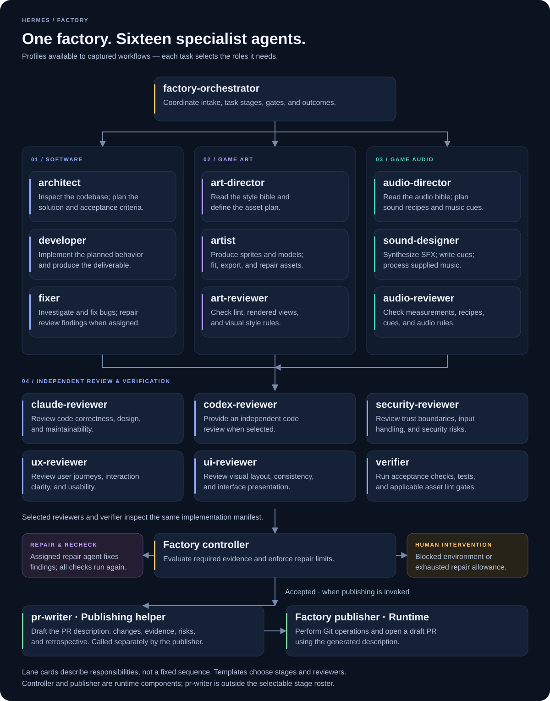

# Hermes Factory Toolkit

Tools and extensions for Hermes Factory workflows: game art and audio production, asset review, workflow migrations, and offline evaluation.

This checkout complements an existing Hermes Factory installation. It is not a standalone Hermes server or dashboard application. Asset linting, sound synthesis, and benchmark tooling can run directly from the checkout; workflow migrations and installed worker skills require the corresponding Factory runtime.

## Agents and workflow

Factory v2 plans the project first: the art/audio directors plan when needed, a human approves the art plan, and the architect splits the work into small dependent tasks. Each task then runs its own cycle of writing, verification, reviews, and bounded specialist repairs; a task that cannot be repaired stops for a human, who can grant more repairs or pick a stronger model.

<p align="center">
  
</p>

Final integration repeats the cycle over the assembled project with the complete review panel, and `factory-retro` then proposes improvements to Factory itself. Existing tasks retain their captured v1 workflows.

See the [project workflow guide](docs/project-workflows.md) for the execution contract, installation, and verification. The runtime source in [`runtime/factory-dashboard`](runtime/factory-dashboard) is installed into an existing Hermes home rather than run from this checkout.

## Requirements

- **Python 3.11+** for the Python tools. The core lint, synthesis, and benchmark code uses only the standard library.
- **FFmpeg** for decoding and processing audio and measuring loudness.
- **Blender** for rendering and inspecting 3D assets.
- **A POSIX shell and `rsync`** for the installer scripts.
- **Hermes Factory and configured worker profiles** for model-backed reviews and managed workflows. Production wrappers may also require their respective generation service credentials or CLI.
- **PyYAML in the Hermes Python environment** for the project workflow installer.

Run the commands below from the repository root. Individual scripts expose their arguments through `--help`.

## Quick start

### Validate the benchmark taskset

This runs offline without a Hermes installation or model calls:

```sh
python3 scripts/factory_benchmark.py taskset --taskset benchmarks/factory-v1
```

Generate a report from the included synthetic example:

```sh
python3 scripts/factory_benchmark.py report \
  --taskset benchmarks/factory-v1 \
  --results benchmarks/factory-v1/examples/results.json \
  --evidence-root benchmarks/factory-v1/examples \
  --output /tmp/factory-benchmark-example
```

The command writes `/tmp/factory-benchmark-example.json` and `/tmp/factory-benchmark-example.md`. These sample results demonstrate report mechanics; they are not measured model performance. See the [benchmark guide](docs/factory-ecc.md) for preparing cases, collecting evidence, and running real trials.

### Lint game assets

Art lint uses the target project's `art/style/STYLE.md` and `art/style/style.json`:

```sh
python3 scripts/art_lint.py /path/to/game --out /tmp/art-lint
```

Audio lint uses `audio/style/AUDIO.md` and `audio/style/audio.json`:

```sh
python3 scripts/audio_lint.py /path/to/game --out /tmp/audio-lint
```

Both commands produce `lint.json` and review images in the output directory. Pass relative asset paths after the game directory to limit the review. Audio lint also supports `--fail-on-blocking` for a nonzero exit on BLOCKER or HIGH findings.

Art checks inspect assets outside the game engine. Model-backed art review is a separate step; see the [art verifier guide](docs/art-verifier.md).

In a Factory run the art reviewer is one final gate: it runs once, on the complete game rendered by Unity, and scores the whole screenshot against the approved reference (minimum 80). It is never run on an individual asset or task; see [Art review only at the end](docs/project-workflows.md#art-review-only-at-the-end).

### Produce audio

Render a sound-effect recipe to a WAV file:

```sh
python3 scripts/sfx_synth.py /path/to/recipe.json /tmp/effect.wav
```

Process an existing music file using a music class defined in the game's audio bible:

```sh
python3 scripts/music_process.py /path/to/incoming.mp3 /tmp/track.ogg \
  --class YOUR_MUSIC_CLASS \
  --bible /path/to/game/audio/style/audio.json
```

The [audio production instructions](audio_production/install/SKILL.md) describe recipe fields, music cues, and import conventions. Music generation itself is handled outside this tool: the processing command consumes a supplied audio file.

## Install worker skills

Install the review and production bundles:

```sh
sh scripts/install_art_review.sh
sh scripts/install_art_production.sh
sh scripts/install_audio_review.sh
sh scripts/install_audio_production.sh
```

The default destination is `~/.hermes/factory-skills/worker`. Set `HERMES_FACTORY_SKILLS` to use another worker-skill directory. Installers refuse to overwrite an existing destination.

The architect's `task-writing` skill (how to write small, checkable tasks) is a runtime skill, kept in [`runtime/factory-skills/worker/task-writing`](runtime/factory-skills/worker/task-writing); copy that folder into the same destination.

Installing skill files does not configure worker profiles or activate workflow types. Review the [art](docs/superpowers/specs/2026-10-26-game-art-factory-design.md) and [audio](docs/superpowers/specs/2026-11-06-game-audio-factory-design.md) integration designs before changing an installed environment. Migration scripts accept explicit runtime paths and provide preview modes:

```sh
python3 scripts/migrate_game_art.py --help
python3 scripts/migrate_game_audio.py --help
python3 scripts/migrate_factory_ecc.py --help
```

The Game Art and Game Audio migrations use `--dry-run`; the ECC migration creates a preview that must be supplied when applying changes. See the [ECC guide](docs/factory-ecc.md) for its activation and rollback procedure.

## Repository layout

```text
art_production/           Art generation and sprite fitting helpers
audio_production/         Sound synthesis and music processing
factory_art/             Art linting, style rules, and model checks
factory_audio/           Audio linting, measurements, and FFmpeg integration
factory_ecc/             Benchmark evidence, reporting, and guidance migration
factory_game_art/        Game Art workflow migration
factory_game_audio/      Game Audio workflow migration
factory_type_migration/  Shared workflow type migration support
scripts/                 Command-line entry points and installers
tests/                   unittest suites grouped by subsystem
benchmarks/              Pinned cases, graders, and synthetic examples
docs/                    Guides, designs, implementation plans, and results
runtime/                 Factory dashboard runtime and worker skills installed into Hermes
reports/                 Retained HTML dashboard snapshots
artifacts/               Archived builds and rollout evidence
```

## Python files: what each one does and what calls it

Every tracked `.py` file outside `tests/` and `artifacts/`. The **Triggered by** column says who or what runs or imports it: a person running a command, a Factory worker following its skill card, Hermes cron (`--no-agent`, no model calls), a Hermes plugin hook, or another module.

### Hermes runtime: control loop and board (`runtime/factory-dashboard/factory_dashboard/`)

Hermes loads this package through the plugin in `runtime/factory-dashboard/integrations/hermes_factory_models/__init__.py`. The plugin registers these hooks: `on_kanban_dispatch_tick`, `kanban_task_completed`, `before_kanban_task_mutation` and `resolve_kanban_worker_model`. Every dispatcher tick and every task completion runs `workflow_controller` → `project_controller`.

| File | What it does | Triggered by |
|---|---|---|
| `workflow_controller.py` | Moves a workflow from one phase to the next and survives restarts. Hermes alone launches the workers. | Plugin hooks (dispatch tick, task completed) |
| `project_controller.py` | Runs a project in two levels (directors → architect → small tasks → integration) through the guarded board API. This is the main brain. | `workflow_controller` |
| `project_cards.py` | Builds the instructions for each stage that a worker receives on its card, including which art, audio or Unity scripts to run. | `project_controller` |
| `project_policy.py` | Pure policy for planning, picking reviewers and specialist repairs. | `project_controller`, `workflow_capture`, `workflow_service` |
| `project_decisions.py` | Human decisions and structured constraints that the controller must honour. | `project_controller`, `project_policy`, `workflow_gate` |
| `project_evidence.py` | Bounded reads of the planning and perception evidence that was kept. | `project_controller` |
| `project_references.py` | Human-approved visual references (`docs/references.json`): their authority, inspection, traceability and contradiction checks. | `project_controller`, `project_evidence` |
| `scene_loop.py` | Keeps a record of attempts in the full-scene repair loop (diagnose → repair → re-render → re-score) so it never loops blindly. | `project_controller` |
| `workflow_gate.py` | Pure policy for reviewing against the same manifest, limiting repairs and escalating to a human. | Controllers |
| `workflow_guards.py` | Policy for managed tasks. Only a scoped in-process controller call can authorize it. | `before_kanban_task_mutation` hook |
| `workflow_handoffs.py` | Normalizes the evidence workers hand back. | Controllers |
| `tool_incidents.py` | Separates tool incidents (environment failures) from real verification blockers. | Controllers, `workflow_gate`, `workflow_handoffs` |
| `workflow_state.py` | Stores the Factory execution identity atomically next to the Hermes board tasks. | Controllers |
| `workflow_cards.py` | Stage bodies that keep the existing worker workspace and artifact contracts. | Controllers |
| `workflow_capture.py` | Picks a task's workflow in the same transaction that captures its models. | Task creation / `factory_creation` |
| `workflow_types.py` / `workflow_templates.py` | Immutable workflow definitions, template revisions with optimistic edits, and a default per task type. | Capture, dashboard, migrations |
| `workflow_runtime.py` | Wires the workflow services together without loading or launching any provider. | Dashboard server, plugin |
| `workflow_service.py` / `workflow_http.py` | Dashboard operations and HTTP routes for workflows. | Dashboard HTTP server |
| `factory_creation.py` | Binds Factory settings before a board task can be dispatched. | Task intake / creation |
| `factory_model_resolver.py` / `frozen_resolver.py` | Decides which model each worker attempt uses, based on the task's immutable captured settings. | `resolve_kanban_worker_model` hook |
| `model_policy.py` / `model_catalog.py` / `policy_store.py` | Immutable model choices, a catalog of models per profile (no credentials), and a revisioned policy database. | Resolver, dashboard |
| `task_identity.py` / `task_settings.py` / `task_settings_store.py` / `task_submission.py` | Task identity, settings snapshots in a SQLite sidecar, and validated submissions that can be recovered. | Capture, resolver, dashboard |
| `settings_migration.py` / `migration_sources.py` | Captures unfinished work into settings snapshots without rewriting history. | `scripts/migrate_factory_task_settings.py` |
| `hermes_compat.py` | Checks whether this Hermes carries the Factory patches it needs. | Plugin load, `run_boards`, deploy, bundling |
| `hermes_intake.py` | Narrow adapter to the queue of the existing Hermes. It never starts intake or workers. | Dashboard |
| `board_registry.py` | Persistent registry of run boards, and the single resolver for which boards the Factory governs. | Run boards, cron scripts, resume, deploy |
| `run_boards.py` | Creates dedicated run boards (idempotent) and runs their lifecycle. | `factory_boards.py`, `runs_service`, intake pump |
| `runs_service.py` / `runs_http.py` | Shows all runs together (the default board plus run boards) and serves the `/runs` routes. | Dashboard HTTP server |
| `http_server.py` | Report server bound to loopback only, with authenticated configuration writes. | `serve_factory_dashboard.py` |
| `live_service.py` / `profile_service.py` / `profile_settings.py` / `snapshot_service.py` | Application operations behind the HTTP server: profiles, defaults and run evidence. | HTTP server |
| `collector.py` / `otel_source.py` / `models.py` / `report.py` / `renderer.py` | Read the selected databases and OTel store, derive report views and write the HTML atomically. | `generate_factory_dashboard.py`, `serve_factory_dashboard.py` |
| `catalog_export.py` | Exports the selected model metadata and never exports secrets. | `export_factory_model_catalog.py` |
| `demo.py` | Fixed demo data for the UI. | Run by hand / tests |

### Hermes runtime: scripts (`runtime/factory-dashboard/scripts/`)

| File | What it does | Triggered by |
|---|---|---|
| `serve_factory_dashboard.py` | Serves the local dashboard and the runs page. | Run by hand / a long-running service |
| `generate_factory_dashboard.py` | Builds an offline HTML dashboard from the selected records. | Run by hand |
| `factory_boards.py` | CLI to inspect and operate run boards (one Hermes board per run). | Run by hand |
| `resume_factory_workflow.py` | Retries a blocked stage after a human decides to recover it. | Human (CLI / dashboard) |
| `factory_resume_rate_limit.py` | Automatically resumes roots that paused only because of a provider rate limit. | Hermes cron, every 2 min |
| `migrate_factory_task_settings.py` | Inspects or applies a settings migration for one board. | Run by hand |
| `export_factory_model_catalog.py` | Exports the models each profile can use (run with the Hermes interpreter). | Run by hand |
| `bundle_factory_plugin.py` | Builds the self-contained plugin directory from this source. | Run by hand before install/deploy |

### Hermes runtime: cron scripts (`runtime/factory-scripts/`)

Deterministic and stdlib only. Hermes cron runs them with `--no-agent`, so they spend zero tokens. Live copies are in `~/.hermes/scripts`.

| File | What it does | Triggered by |
|---|---|---|
| `factory_intake.py` | Intake pump: turns Triage tickets into FACTORY roots and run boards. | Cron |
| `factory_watchdog.py` | Recovers ENVIRONMENT blocks on roots and leaves every judgment call to the human. | Cron |
| `factory_alerts.py` | Prints one message for each situation it newly notices. Hermes sends the output to Telegram. | Cron |
| `factory_publish.py` | Publishes each finished FACTORY root (host code, not a worker). | Cron |
| `factory_patch_check.py` | Guard that alerts when Hermes has lost the Factory patches (for example after an update). | Cron |
| `factory_resume_rate_limit.py` | Same job as the dashboard copy: resumes roots that paused on a rate limit. | Cron |
| `factory_status.py` | Plain-English status of a job. | Human: `factory_status.py [root] [--board B]` |
| `factory_ticket.py` | Drops a ticket into the intake queue. | Human / Telegram request |
| `factory_secrets.py` | Checks and provisions the scoped secrets workers need, without ever printing a value. | Human |
| `factory_lib.py` | Shared helpers for the scripts above. | Imported by the cron scripts |
| `tests/*.py` | Run the real scripts in a sandbox with a temporary HOME. | `python3 tests/test_x.py` |

### Other runtime files

| File | What it does | Triggered by |
|---|---|---|
| `runtime/deploy_multi_board.py` | Syncs the multi-board Factory from tracked source into `~/.hermes`. It restarts nothing. | Human, during a deploy |
| `runtime/kanban-plugin/plugin_api.py` | Backend API of the patched Kanban dashboard plugin (`/api/plugins/kanban/`), including the awaiting-approval column. | Hermes dashboard web server |
| `runtime/hermes-patches/hermes_patches.py` | Checks, reapplies and exports the Factory's git patches to the Hermes source. | Human after a Hermes update, `factory_patch_check`, `hermes_compat` |
| `runtime/hermes-patches/probe_owner_model.py` | Behavioural probe: does the kanban owner really run the model that was captured? | `factory_patch_check` / human |
| `runtime/factory-skills/worker/factory-worker/scripts/fw.py` | Worker helper (manifests and handoffs). It never runs git. | Factory workers, from their skill card |

### Art, audio and Unity libraries

Workers do not import these libraries directly. They reach them through the `scripts/` CLIs listed in the next section, which the cards from `project_cards.py` tell them to run.

| File | What it does | Used by |
|---|---|---|
| `art_production/sprite_fit.py` | Turns a concept image into a game asset: nearest-neighbour fit, palette, flat background to alpha. | `scripts/sprite_fit.py`, `scripts/sprite_sheet.py` |
| `art_production/sheet.py` | Slices a generated sheet laid out as a grid into named sprites. | `scripts/sprite_sheet.py` |
| `art_production/sizing.py` | Picks the pixel size of an asset when the task gives none. | `scripts/asset_size.py` |
| `art_production/tripo.py` | Tripo3D client: image → GLB. | `scripts/tripo_model.py` |
| `audio_production/synth.py` | sfxr-style SFX synthesis from a JSON recipe (deterministic). | `scripts/sfx_synth.py` |
| `audio_production/music.py` | Turns a Suno file into a game track: trim, loop, loudness, encode. | `scripts/music_process.py` |
| `factory_art/lint.py` | Deterministic art lint against the style bible, and prepares images for the vision review. | `scripts/art_lint.py` |
| `factory_art/style_bible.py` | Loads and validates the art bible and matches files to its asset classes. | `lint.py` |
| `factory_art/sprite_checks.py` / `model_checks.py` / `text_checks.py` | Measurable checks for sprites, 3D models and game text. | `lint.py` |
| `factory_art/png.py` | Minimal PNG codec in the standard library. | Every art module, `scripts/check_png.py` |
| `factory_art/views.py` | Upscaled sprite views and model contact sheets for the vision pass. | `lint.py` |
| `factory_art/findings.py` | Shared finding records. | Every art check |
| `factory_art/blender_runner.py` + `blender/render_model.py` | Finds Blender and renders or measures a model inside it. | `lint.py` (headless Blender) |
| `factory_art/similarity.py` | Cheap check of each asset against its reference images. | `scripts/art_similarity.py` |
| `factory_art/scene_score.py` | Scores the whole rendered scene against the approved reference. | `scripts/scene_score.py` |
| `factory_audio/lint.py` | Deterministic audio lint, writes `lint.json` and review pictures. | `scripts/audio_lint.py` |
| `factory_audio/bible.py` / `measure.py` / `wavio.py` / `ffmpeg.py` | Audio bible loader, sample measures, WAV I/O, and safe ffmpeg calls. | `factory_audio/lint.py`, `audio_production/music.py` |
| `factory_unity/layout.py` | The scene layout contract (`factory-scene-layout/v1`) and its completeness check. | `scene_capture.py`, cards |
| `factory_unity/scene_capture.py` | Builds a real Unity scene from a layout and captures it. | `scripts/unity_scene_capture.py` |

### Benchmark and migration libraries

| File | What it does | Used by |
|---|---|---|
| `factory_ecc/tasksets.py` / `graders.py` / `results.py` / `trial_set.py` / `reporting.py` / `files.py` | Pinned tasksets, grading inputs, validation of imported evidence and reports. They never run candidate code. | `scripts/factory_benchmark.py` |
| `factory_ecc/guidance.py` / `migration.py` | ECC-derived guidance saved as workflow templates. | `scripts/migrate_factory_ecc.py` |
| `factory_type_migration/migration.py` | Generic, reversible "add a task type" (roles, catalog, template, default). | The two modules below |
| `factory_game_art/migration.py` / `factory_game_audio/migration.py` | Game Art / Game Audio type specs. | `scripts/migrate_game_art.py` / `migrate_game_audio.py` |
| `benchmarks/factory-v1/graders/*.py` | Trusted fixture checks for each benchmark case. | The benchmark grader, inside a disposable sandbox only |
| `benchmarks/factory-v1/{cases,examples}/**/solution.py` | Fixture source code under test, not tools. | Graders |

### Command-line scripts (`scripts/`)

| File | What it does | Triggered by |
|---|---|---|
| `art_lint.py` | Lints art against the bible and prepares review images. | Art reviewer worker / human |
| `art_similarity.py` | Scores renders against references with a vision model on OpenRouter (gate 80%). | Art reviewer worker |
| `scene_score.py` | Scores the whole scene against the approved reference (gate 80). | Scene review stage worker |
| `unity_scene_capture.py` | Captures a Unity scene in an isolated clone and never modifies the project. | Unity/scene stage worker |
| `sprite_fit.py` / `sprite_sheet.py` / `asset_size.py` / `check_png.py` | Fit, slice, size and validate generated art. | Art production worker |
| `tripo_model.py` / `blender_model.py` | Image → GLB through Tripo, and Blender-side model processing (run with `blender_run.sh`). | Art production worker |
| `audio_lint.py` / `sfx_synth.py` / `music_process.py` | Lint audio, synthesize SFX, process music. | Audio worker / human |
| `factory_benchmark.py` | Prepares benchmark inputs and reports results offline. | Human |
| `install_project_workflows.py` | Previews or installs project workflows, with backups. | Human, during install |
| `migrate_factory_ecc.py` / `migrate_game_art.py` / `migrate_game_audio.py` | Apply or revert workflow and type migrations. | Human |
| `check_game_art_install.py` / `check_game_audio_install.py` | Read-only checks of an install. | Human |
| `make_art_sample.py` / `make_audio_sample.py` | Create sample game repos for paid end-to-end runs. | Human |
| `factory_secrets.py` | Same tool as `runtime/factory-scripts/factory_secrets.py`. | Human |
| `run_all_tests.py` | Runs every suite and can compare failures against a baseline git ref. | Human / CI |

### Not covered above

- `tests/**` holds unittest suites (`python3 -m unittest discover -s tests/<suite>`) and is not called by the runtime.
- `artifacts/**` holds frozen snapshots of past builds and rollouts, kept as evidence. Nothing runs them.
- `__init__.py` files only mark packages.

## Verification

Run a subsystem's tests with Python's built-in test runner:

```sh
python3 -m unittest discover -s tests/ecc -p 'test_*.py' -v
python3 -m unittest discover -s tests/art -p 'test_*.py' -v
python3 -m unittest discover -s tests/audio -p 'test_*.py' -v
```

Additional suites are in `tests/production`, `tests/factory_art_type`, `tests/factory_audio_type`, `tests/factory_worker` (the manifest helper) and `tests/hermes_patches` (the Hermes patch tool); run them with the same discovery command and the corresponding directory. Some checks depend on external tools or an installed runtime. The live grader check described in the benchmark guide additionally requires Docker and the Factory runtime image.

## Further reading

- [Workflow templates and captured task settings](docs/factory-workflows.md)
- [Factory dashboard snapshots](docs/factory-dashboard.md)
- [Timeline controls](docs/factory-timeline-controls.md)
- [PR writer behavior](docs/factory-pr-writer.md)

Some operational guides reference scripts in the owning Hermes home or a separate dashboard worktree. Retained artifacts and reports record particular rollouts rather than the current state of a running Factory.
